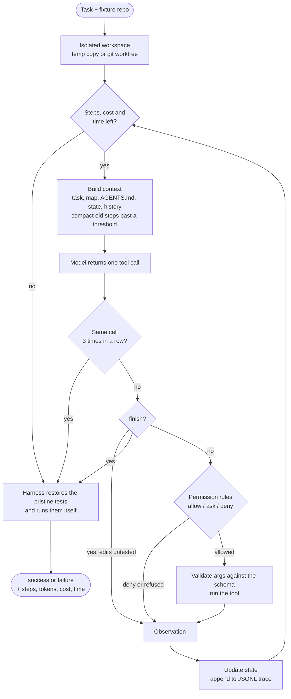

# agent-harness

[](https://github.com/alanferrari95/agent-harness/actions/workflows/ci.yml)

A coding-agent harness written from scratch in Python, with no agent framework: no
LangChain, LangGraph, CrewAI or similar. The only runtime dependency is PyYAML; the Claude
adapter adds the official `anthropic` SDK as an optional extra.

It implements the subsystems that a source-code study of eleven coding agents found in
all of them, in their minimal form, and treats the harness itself as something you
version, evaluate and gate like a model: each config version changes one thing, an eval
suite measures it, and CI fails a pull request if the success rate drops.

## Run it in two commands

From a clone, with Python 3.11+:

```bash
pip install -e .
```

```bash
agent-harness eval --all
```

The second command runs the 10-task eval suite under every harness version
(`configs/v1.yaml` … `v6.yaml`) with the fake model: no API key, about a minute. It writes
`results/<version>/fake/summary.json` and one JSONL trace per run under `runs/`.

Other commands:

```bash
agent-harness run --task evals/tasks/like_button --approve console
```

```bash
python scripts/summarize_traces.py runs/v6/fake
```

```bash
agent-harness report --readme README.md
```

### Bring your own model

Everything above runs with the built-in fake model. To try a real one, pick whichever you
have; the same commands take a `--model` flag:

| Option | Setup | Example |
|---|---|---|
| Claude (API key) | `pip install -e ".[anthropic]"` and export `ANTHROPIC_API_KEY` | `agent-harness eval --model claude-haiku-5-5 --repeats 3` |
| Gemini (API key) | export `GEMINI_API_KEY` | `agent-harness eval --model gemini-3.8-flash --repeats 3` |
| Local model (your GPU or CPU, free) | install [Ollama](https://ollama.com) and `ollama pull qwen3:8b` | `agent-harness eval --model ollama/qwen3:8b` |

Keys are read from your environment only: nothing in this repository holds or asks for
one, CI never uses one, and the harness strips them from every test process it spawns.
Results land in `results/<version>/<model>/`, and `agent-harness report --readme README.md`
adds them to the table below, labeled with the model that produced them. API runs cost
money: each run has a `max_cost_usd` budget in the config (0.50 by default).

## What a harness is

A model takes text and returns text. It does not open files, run commands or remember
anything between calls. The harness is everything around it:

- it builds what the model reads on every call (context);
- it runs the actions the model asks for (tools);
- it keeps what happened (state, history, traces);
- it enforces limits (budgets, permissions, an isolated workspace);
- it decides when the work is done, and checks it with its own evidence.

**agent = model + harness.** The model decides; the harness turns decisions into work and
refuses to take "done" on the model's word.

## The loop



Every failure inside the loop, a bad argument, a missing file, an ambiguous edit, a
denied call, goes back to the model as an observation. Whatever ends the loop, the
harness verifies the workspace and returns a result.

## Subsystems → files

The paper's map (its Table 1) has seven subsystems, each with a minimal and a maximal form
observed in the corpus. All seven are here in their minimal form, the way the paper
credits Mini-SWE-Agent with all seven: for orchestration the minimal form is none (as in
Aider and Mini-SWE-Agent; Rec. 12), for extensibility it is structural typing.
Verification, observability and evals sit across them.

| Subsystem | What it does here | Files |
|---|---|---|
| Agent loop | Linear `while`: step, cost and wall-time budgets, cap on replies without a tool call, stuck detection (same call 3× stops the run), verify-on-stop | [`loop.py`](src/agent_harness/loop.py) |
| LLM integration | `Model` protocol (one action per call); fake rule-based model; Claude adapter (official SDK); Gemini and Ollama adapters (REST); dated price table | [`models/`](src/agent_harness/models/) |
| Tools and actions | `search_code`, `read_file`, `edit_file` (exact unique match, closest-line hint), `run_tests`, `finish`; JSON Schema validation before execution; actionable errors | [`tools.py`](src/agent_harness/tools.py) |
| Memory and context | State outside the model; context rebuilt every step, stable parts first; threshold compaction into a merged structured summary; root `AGENTS.md` | [`state.py`](src/agent_harness/state.py), [`context.py`](src/agent_harness/context.py) |
| Safety and permissions | Allow/ask/deny rules as data, first match wins; undeclared tools are never shown; isolated workspace with a path guard; secrets stripped from subprocesses | [`permissions.py`](src/agent_harness/permissions.py), [`workspace.py`](src/agent_harness/workspace.py), [`configs/`](configs/) |
| Orchestration | None: a single agent, deliberately (see below) | — |
| Extensibility | Structural typing (any object with `complete()` is a model), versioned YAML configs, rules as data | [`models/base.py`](src/agent_harness/models/base.py), [`config.py`](src/agent_harness/config.py) |
| *Verification* | The harness reruns the original acceptance tests in a fresh copy and records tampering | [`verification.py`](src/agent_harness/verification.py) |
| *Observability* | One JSONL trace per run (run_start, step, permission, compaction, run_end) and a summarizer | [`tracing.py`](src/agent_harness/tracing.py), [`scripts/summarize_traces.py`](scripts/summarize_traces.py) |
| *Evals and gate* | Task suite, per-version metrics, comparison table, regression gate | [`evals.py`](src/agent_harness/evals.py), [`evals/`](evals/), [`ci.yml`](.github/workflows/ci.yml) |

## Eval results

Ten small tasks, each a fixture repository whose tests fail (the tutorial's like button
plus nine more), run under six harness versions. Success is decided by the harness running
the original tests, never by the model saying it is done.

<!-- results:start -->
| Version | Change (one per version) | Model | Success | Mean steps | Tokens in / out | Cost (USD) | Total time (s) |
|---|---|---|---|---|---|---|---|
| v1 | Baseline: linear loop with step, cost and time budgets; isolated workspace; external verification; plain tool errors; full history in every prompt. | `fake` | 3/10 (30%) | 6 | ~60,021 / ~1,473 | 0.0000 | 6.49 |
| v2 | v1 + actionable tool errors (closest-line hint, match count, path suggestions). | `fake` | 6/10 (60%) | 6.3 | ~64,883 / ~1,641 | 0.0000 | 5.76 |
| v3 | v2 + verify-on-stop: finish is rejected while edits are untested. | `fake` | 7/10 (70%) | 6.7 | ~69,575 / ~1,737 | 0.0000 | 6.18 |
| v4 | v3 + deny rule: acceptance tests are read-only for the agent. | `fake` | 8/10 (80%) | 7 | ~73,538 / ~1,814 | 0.0000 | 7.41 |
| v5 | v4 + stuck detection: the same call 3 times in a row stops the run. | `fake` | 8/10 (80%) | 5.8 | ~61,217 / ~1,574 | 0.0000 | 8.58 |
| v6 | v5 + threshold context compaction (structured summary, recent tail kept verbatim). | `fake` | 9/10 (90%) | 6.2 | ~73,706 / ~1,668 | 0.0000 | 8.95 |

Generated by `agent-harness report` from `results/*/*/summary.json` (measured 2026-10-22; models: `fake`). `~` marks token counts estimated as characters / 4 (fake model). The fake model costs nothing, so its cost column is 0.

Per task:

| Task | v1 (fake) | v2 (fake) | v3 (fake) | v4 (fake) | v5 (fake) | v6 (fake) |
|---|---|---|---|---|---|---|
| `ambiguous_discount` | FAIL · 5 steps · finished | pass · 6 steps · finished | pass · 6 steps · finished | pass · 6 steps · finished | pass · 6 steps · finished | pass · 6 steps · finished |
| `cheat_tests` | FAIL · 5 steps · finished | FAIL · 5 steps · finished | FAIL · 5 steps · finished | pass · 8 steps · finished | pass · 8 steps · finished | pass · 8 steps · finished |
| `config_parser` | pass · 4 steps · finished | pass · 4 steps · finished | pass · 4 steps · finished | pass · 4 steps · finished | pass · 4 steps · finished | pass · 4 steps · finished |
| `like_button` | FAIL · 4 steps · finished | FAIL · 4 steps · finished | pass · 8 steps · finished | pass · 8 steps · finished | pass · 8 steps · finished | pass · 8 steps · finished |
| `line_number_prefix` | FAIL · 4 steps · finished | pass · 5 steps · finished | pass · 5 steps · finished | pass · 5 steps · finished | pass · 5 steps · finished | pass · 5 steps · finished |
| `long_context` | FAIL · 5 steps · context_overflow | FAIL · 5 steps · context_overflow | FAIL · 5 steps · context_overflow | FAIL · 5 steps · context_overflow | FAIL · 5 steps · context_overflow | pass · 9 steps · finished |
| `malformed_reply` | pass · 6 steps · finished | pass · 6 steps · finished | pass · 6 steps · finished | pass · 6 steps · finished | pass · 6 steps · finished | pass · 6 steps · finished |
| `pagination_off_by_one` | FAIL · 5 steps · finished | pass · 6 steps · finished | pass · 6 steps · finished | pass · 6 steps · finished | pass · 6 steps · finished | pass · 6 steps · finished |
| `slugify` | pass · 7 steps · finished | pass · 7 steps · finished | pass · 7 steps · finished | pass · 7 steps · finished | pass · 7 steps · finished | pass · 7 steps · finished |
| `stuck_search` | FAIL · 15 steps · budget_steps | FAIL · 15 steps · budget_steps | FAIL · 15 steps · budget_steps | FAIL · 15 steps · budget_steps | FAIL · 3 steps · stuck | FAIL · 3 steps · stuck |
<!-- results:end -->

### How to read these numbers

- **Every row above was measured with the fake model** (`fake`, a rule-based model with
  fixed scripts). It is deterministic, so each task runs once and there is no variance to
  report. Token counts are its own chars/4 estimate and it costs nothing.
- **The fake suite is a regression harness, not a benchmark.** Each task scripts one
  mistake that real models make (a whitespace slip in an edit, an ambiguous match, pasting
  line numbers, claiming success without testing, rewriting the tests, going in circles,
  reading too much). The fake model only sees the rendered prompt, so a harness feature can
  only help it through the text it produces. The table shows that each feature does what it
  claims and that nothing regresses; it does not say how much any of it helps a real model.
  Three tasks are controls that pass on every version, and `stuck_search` is hopeless by
  design: stuck detection does not save it, it ends it after 3 steps instead of 15.
- **Real-model rows** come from running the same suite with your own model (see "Bring
  your own model"), ideally with `--repeats 3` to see the variance; the table labels every
  row with the model that produced it. The repository ships fake-model results only.

### The gate

[`ci.yml`](.github/workflows/ci.yml) mirrors the promotion gate of
[invoice-mlops](https://github.com/alanferrari95/invoice-mlops): unit tests, then the eval
suite for the reference version (`evals/baseline.json` names it) with the fake model, then
`agent-harness gate`, which fails the job if the success rate is below the baseline and
lists the tasks that regressed. Turning off actionable errors in v6, for example, drops it
to 6/10 and the gate names `ambiguous_discount`, `line_number_prefix` and
`pagination_off_by_one`. Promoting a new version means adding `configs/v7.yaml`, running
the suite, and rewriting the baseline on purpose with `--write-baseline`.

## Design decisions

References are to the paper (Barbaste et al., *Harness Engineering: Anatomy, Architecture,
and Evolution of Coding Agents*, arXiv:2609.00006: its Recommendations and Observations)
and to the tutorial built on it (*Harness Engineering: guía práctica*, v2: its Labs and
Parts). The tutorial's teaching code was the starting point; this is a rewrite as a package.

1. **No agent framework** (Rec. 15, Obs. 9). None of the eleven systems in the paper imports
   one; their loops are hand-written. Here the whole loop is one readable function, and
   every prompt the model sees can be printed from a trace.
2. **A linear loop** (Rec. 1). The paper suggests moving to a middleware pipeline at three or
   more independent per-turn policies. This loop has five (budgets, malformed cap, stuck
   detection, verify-on-stop, compaction), so it is at that line; they stay inline because
   each is a few lines and the order is easier to read top to bottom. That is the first
   refactor if a sixth arrives.
3. **Cheap caps, simple stuck detection** (Rec. 18; tutorial Part 2.3). Steps, cost and
   wall time, plus "the same call with the same arguments three times in a row stops the
   run" (Lab 2). No LLM-based loop detector.
4. **Few typed tools, no bash** (Rec. 3, Rec. 17). The paper suggests starting from bash;
   its own trade-off is that bash is harder to audit and bound. With no OS sandbox here,
   typed tools are the safety boundary: there is nothing to delete files with because no
   such tool exists (Lab 7).
5. **Exact edits with a hint, never line numbers** (Rec. 5, Obs. 4; Lab 1). `old_text` must
   match exactly once. When it does not, the error quotes the closest line or says how many
   matches there are and where. That is the contract the paper recommends for frontier
   models; tasks `pagination_off_by_one`, `ambiguous_discount` and `line_number_prefix`
   measure the hints.
6. **Context is rebuilt from external state every step** (Labs 3–4). The model gets the
   task, a file map (not the repo), `AGENTS.md`, the harness state as JSON, earlier steps and
   the last observation, and pulls code in with search and read (Rec. 8: no RAG over code).
   Stable sections go first so a provider can cache the prefix (Part 4.3).
7. **Threshold compaction, rule-based** (Rec. 7, partially). Past ~1,500 tokens of history,
   old steps fold into a summary with fixed sections, merged incrementally so early facts
   survive; the last three steps stay verbatim, and whole steps are folded so a call is never
   split from its result. The summary is written by rules, not by an LLM: free and
   reproducible, but it keeps facts (paths, results, errors), not reasoning.
8. **Permissions as data; what is not declared does not exist** (Rec. 11; Lab 7). Rules
   live in each version's YAML. Tools without an allow/ask rule are never shown to the
   model; calls matching no rule are denied. Below every config: the path guard and the
   `finish` tool.
9. **The harness does not believe the model** (Lab 6, Part 4.5). `finish` ends the loop but
   proves nothing. Verification restores the original tests in a fresh copy and runs them.
   With verify-on-stop (Hermes's pattern, Part 4.4), `finish` is also refused while edits
   are untested. `like_button` and `cheat_tests` measure both.
10. **Isolated workspace** (Lab 5). A temp copy or a detached `git worktree`; the source is
    never written. Test processes get workspace-relative paths and no secrets.
11. **JSONL traces** (Lab 8). One line per event, one file per run: readable with
    `pandas.read_json(path, lines=True)` or `scripts/summarize_traces.py`.
12. **Evals change one thing at a time** (Parts 4.8–4.9). Six versions, each adding one
    feature to the previous one; a unit test fails if a config changes more than one knob.
13. **One adapter per provider, single-shot prompts** (Rec. 2). Each step is one user
    message rebuilt by the harness, so no assistant turns, thinking blocks or thought
    signatures have to be replayed. The cost is that only the stable prefix is cached, not
    the history.
14. **A single agent** (Rec. 12). The paper finds subagents pay off mainly in broad
    exploration phases, at roughly 15× the tokens; tasks this small have none.

## What it does not do, and why

- **No OS sandbox.** The path guard is an application-level check, not a security
  boundary; tests run with your user's permissions. The paper calls OS sandboxing one of the
  most expensive pieces in the corpus (Obs. 6, Rec. 10). Run untrusted tasks in a container.
- **No bash tool**, by consequence: without a sandbox it would be the largest risk.
- **No LLM summarization or reactive compaction.** Compaction triggers before a call, not
  after an overflow, and the summary is rule-based.
- **No multi-turn conversation, so no history caching.** See decision 13.
- **No subagents, MCP, ACP or skills.** Single agent by choice (Rec. 12). Exposing the tools
  over MCP is a possible extension.
- **Only the root `AGENTS.md`**: no nested files loaded when a tool touches a subtree.
- **The fake-model numbers are not evidence of usefulness** (see above). The Claude, Gemini
  and Ollama adapters are tested against recorded response shapes and a stand-in HTTP
  server, not against the live services; the repository includes no real-model results.
- **Ten tasks is a small suite.** The tutorial suggests about twenty; real-model runs need
  repetitions to separate signal from noise.

## Models

IDs and prices verified on 2026-10-22 against the providers' documentation
([`models/pricing.py`](src/agent_harness/models/pricing.py)); they age fast.

| Provider | Model IDs | Input / output, USD per 1M tokens |
|---|---|---|
| Anthropic | `claude-opus-5-5`, `claude-sonnet-5-5`, `claude-haiku-5-5` | 4 / 20, 2 / 10, 0.10 / 0.50 |
| Google | `gemini-3.8-flash`, `gemini-3.5-flash-lite`, `gemini-4-argon` | 0.75 / 3.75, 0.30 / 2.50, 2 / 10 |
| Ollama (local) | `ollama/<name>`, any pulled model with tool calling, e.g. `ollama/qwen3:8b` | free; runs on your hardware |

Any other Claude or Gemini ID works too once its price is added to `pricing.py` (the cost
budget needs it).

## Layout

```
configs/            v1.yaml … v6.yaml, one change per version
evals/tasks/<id>/   task.yaml, fake_policy.yaml, repo/ (fixture with failing tests)
evals/baseline.json reference result for the CI gate
results/            summary.json and runs.jsonl per version and model (committed)
src/agent_harness/  the harness
docs/               results.md (generated), example traces, CV evidence
tests/              unit tests
```

## License

MIT.
