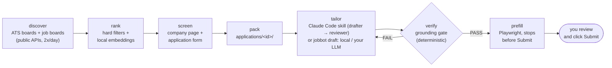

# jobbot

[](https://github.com/alanferrari95/jobbot/actions/workflows/ci.yml)

A personal job-search agent I use every day. It pulls postings from company ATS boards and job boards, ranks them
against my profile with local embeddings, lets a coding agent (Claude Code) tailor the CV and the form answers,
**blocks anything the agent wrote that my profile doesn't back**, and prefills the application form.
**I click Submit.**

Why: tailoring a CV per job is where LLMs help most and where they hurt most. They are good at choosing what to
emphasize and bad at not inventing a number. So the model only *selects and phrases*; a deterministic checker
outside the model decides whether the result is true; and a human makes the final, irreversible click.

## How it works



| Step | What happens | Code |
|---|---|---|
| discover | 112 curated company boards (Greenhouse, Lever, Ashby), ~350 more found in open company directories, an open daily index of ATS postings, and job boards with public APIs (Remotive, Himalayas, Get on Board, RemoteOK, Jobicy, We Work Remotely, Workable, Torre, HN "Who is hiring"). | [sources.py](jobbot/sources.py), [discovery.py](jobbot/discovery.py), [atsindex.py](jobbot/atsindex.py) |
| rank | Hard filters first (title, seniority, location/eligibility, languages, salary floor, required tech I never used), then a 0–10 score: CV fit = how much of the posting my real bullets cover, with a multilingual sentence-embedding model run locally (ONNX via fastembed, no API), embeddings cached in SQLite. | [match.py](jobbot/match.py), [semantic.py](jobbot/semantic.py) |
| screen | For the best ones: find the posting on the company's own board, check it is open and where it really is, and read the form's required questions (citizenship, currency, work authorization). Measured against my real accept/reject decisions with `jobbot verify-test`. | [screening.py](jobbot/screening.py), [formgate.py](jobbot/formgate.py) |
| pack | One folder per job with the posting and a tailoring spec that starts as the full base CV. | [pipeline.py](jobbot/pipeline.py) |
| tailor | Claude Code follows a written playbook: a **drafter** reorders bullet ids and rewrites title, summary and answers; an independent **reviewer** pass reads it as the hiring manager. Without an agent session, `jobbot draft` does it with the backend you choose (below). | [.claude/skills/tailor-cv/SKILL.md](.claude/skills/tailor-cv/SKILL.md), [drafter.py](jobbot/drafter.py) |
| verify | The grounding gate (below). | [grounding.py](jobbot/grounding.py) |
| prefill | Opens the original form in Chrome, uploads the CV, fills every question it has a grounded answer for, declines EEO questions, outlines the Submit button in red and waits. | [autofill.py](jobbot/autofill.py) |

A local dashboard (FastAPI + one HTML file) tracks everything: jobs, applications, recruiter leads, post drafts.


## The grounding gate

The single source of truth is [`profile/base_cv.yaml`](examples/profile/base_cv.yaml): every real fact, each bullet
with an id, the skills I have used, and a `never_claim` list of technologies I have not. The agent's output is a
small spec over it ([example](examples/demo/agent_output/greenhouse-northwind-ai-4001001/cv.yaml)), so it *cannot*
write a new bullet. `jobbot verify <id>` then checks, without any model:

- **Structure**: every bullet id and every skill item exists in the profile (unknown ids fail at resolve time).
- **Free text** (title, summary, every form answer, the cover letter): no number that isn't in the profile
  (answers may also quote numbers from the posting), no `never_claim` technology, and no known technology that the
  profile never mentions.
- **The rendered PDF**: newer than the spec, at most 2 pages, text-extractable (ATS), with email, phone, LinkedIn
  and the standard sections, and no placeholders.
- **Keywords** (warnings only): posting keywords covered, true-but-missing, and asked-but-never-claim.

Errors block `jobbot apply` and the dashboard's prefill. This is what the offline demo prints for a tailoring with
three typical hallucinations ([the agent output](examples/demo/agent_output/lever-contoso-labs-c0a1e5d2-0001/)):

```text
# Verify: lever-contoso-labs-c0a1e5d2-0001
**Result: FAIL**
## Errors
- skill not in base_cv.yaml: 'LangChain'
- title/summary: number '75' does not appear in the profile
- title/summary: mentions Kubernetes, which is in never_claim (not used by the candidate)
- title/summary: mentions LangChain, which the profile doesn't mention
- answers.yaml [How many years of experience do you have]: number '8' does not appear in the profile
- PDF mentions Kubernetes, which is in never_claim (not used by the candidate)
```

The gate is the most tested part of the repo: [tests/test_grounding.py](tests/test_grounding.py).
It is deliberately conservative: it catches invented numbers and tools, not every possible overstatement in
wording, which is what the reviewer pass and my own read are for.

## Design principles

- **Grounding outside the model.** The model selects and phrases; code decides what is true. Facts live in one
  file, and the agent references them by id.
- **Human in the loop for anything irreversible.** Nothing is ever submitted, sent or published by jobbot. Prefill
  stops before Submit; outreach messages and LinkedIn posts are drafts you send yourself; salary and start-date
  answers stay empty until you confirm them.
- **No LinkedIn scraping.** jobbot never logs in to LinkedIn or automates it: it only builds search links that you
  open, and you paste anything useful into the dashboard.
- **No auto-submit, no CAPTCHA solving.** The browser runs visibly, in a dedicated profile, and you solve any
  CAPTCHA and click Submit.
- **Respect the sources' terms.** Job data comes only from public APIs and feeds (ATS posting APIs, job-board
  APIs and RSS), with a descriptive User-Agent, backoff on 429/5xx and links back to the source. No HTML scraping
  in this repo; anything you add locally (`profile/local_sources.py`) is your call and stays out of it.
- **Local first, bring your own model.** Embeddings run on your machine, data stays in a local SQLite file, the
  dashboard binds to 127.0.0.1. Nothing needs an API key; an LLM drafter is opt-in, with your key or your GPU.

## Run it

Requires Python 3.12+.

```bash
git clone https://github.com/alanferrari95/jobbot && cd jobbot
python -m venv .venv && . .venv/bin/activate        # Windows: .venv\Scripts\activate
pip install -e ".[dev]"
```

**Offline demo** (fictional profile, 15 recorded postings from 4 fictional companies, no accounts, no network; the
embedding model and PDF renderer are swapped for offline stand-ins, so scores are only illustrative):

```bash
jobbot demo                 # discover -> rank -> pack -> replayed agent output -> verify (one PASS, one FAIL),
                            # then a local `jobbot draft` (no LLM) that passes the gate
jobbot --demo list
jobbot --demo web           # dashboard on http://127.0.0.1:8766 with the demo data
```

**Real use**:

1. Copy `examples/profile/` to `profile/` (git-ignored) and replace it with your own facts and rules.
2. `jobbot discover` (the first run downloads the ~240 MB embedding model to `.models/`), then `jobbot list`.
3. `jobbot pack <id>` and ask Claude Code, in this folder, to tailor the CV for `<id>` (it picks up the skill).
4. `jobbot verify <id>`, then `jobbot apply <id>`: Chrome opens with the form filled in; review and submit.
5. Optional: `jobbot daily` twice a day ([Windows and cron instructions](docs/scheduling.md)) and `jobbot web`.

**Tailoring without an agent session**: `jobbot draft <id>` writes the tailoring spec, renders it and runs the gate.
Pick what runs it:

| `--drafter` | Needs | What it does |
|---|---|---|
| `local` (default) | nothing | Deterministic, no LLM: orders each role's bullets by how much of the posting they cover (local embeddings) and puts the skills the posting names first. Title and summary stay as in your profile. |
| `gemini` | your `GEMINI_API_KEY` | Gemini through Google's OpenAI-compatible endpoint rewrites title and summary and picks bullets and skills. |
| `ollama` | your GPU (or CPU) and [Ollama](https://ollama.com) | The same, with a local model (`JOBBOT_LLM_MODEL`, default `llama3.1:8b`). |
| `openai-compatible` | `JOBBOT_LLM_BASE_URL`, `JOBBOT_LLM_MODEL`, maybe `JOBBOT_LLM_API_KEY` | Any `/v1/chat/completions` server: vLLM, LM Studio, a hosted API. |

With an LLM backend, the gate's errors are sent back to the model for a corrected answer (up to 3 tries), and the
result still has to pass `jobbot verify` before you can apply. Set `drafter:` and `auto_draft: true` in
`targets.yaml` to draft every job that `jobbot daily` prepares.

Data goes to `applications/`, `cv/` and `logs/` next to the code (or `--home DIR` / `JOBBOT_HOME`); none of it is
committed. Run `pytest` and `ruff check .` for the checks CI runs.

## What my CV says about it, and where to check

| CV bullet | Files | Evidence |
|---|---|---|
| Pulls postings twice a day from 112 company ATS boards (Greenhouse, Lever, Ashby) and job boards, and ranks them against my profile with local multilingual sentence embeddings (ONNX, cached in SQLite). | [sources.py](jobbot/sources.py) (`greenhouse`, `lever`, `ashby`, `BOARDS`), [examples/profile/companies.yaml](examples/profile/companies.yaml) (the 112 boards), [scripts/run_daily.*](scripts/) + [docs/scheduling.md](docs/scheduling.md) (09:00 and 19:00), [semantic.py](jobbot/semantic.py) (`paraphrase-multilingual-MiniLM-L12-v2` through fastembed/ONNX, `emb` table), [match.py](jobbot/match.py) (`evaluate_many`) | [test_sources.py](tests/test_sources.py) (parsers on recorded Greenhouse, Lever and Ashby responses), [test_semantic.py](tests/test_semantic.py) (model mocked: chunking, cache, CV fit), [test_match.py](tests/test_match.py) |
| A coding agent (Claude Code) tailors each CV and form answer from a single source-of-truth profile, following a written playbook with a drafter–reviewer pass. | [.claude/skills/tailor-cv/SKILL.md](.claude/skills/tailor-cv/SKILL.md) (drafter → reviewer → gate), [examples/profile/base_cv.yaml](examples/profile/base_cv.yaml), [pipeline.py](jobbot/pipeline.py) (`pack`, `spec_template`, task queue), [cv.py](jobbot/cv.py) (`resolve`), [drafter.py](jobbot/drafter.py) (the same loop without an agent session) | [examples/demo/agent_output/](examples/demo/agent_output/) (a grounded and a hallucinated output), [test_resolve.py](tests/test_resolve.py), [test_drafter.py](tests/test_drafter.py), `jobbot demo` |
| Verification outside the model: a deterministic checker blocks any claim, number or technology not in the profile; Playwright prefills the form and stops before Submit for human approval. | [grounding.py](jobbot/grounding.py), [autofill.py](jobbot/autofill.py) (no code path clicks Submit), [__main__.py](jobbot/__main__.py) and [web.py](jobbot/web.py) (`apply` refuses to run unless verify passes) | [test_grounding.py](tests/test_grounding.py), [test_demo_and_web.py](tests/test_demo_and_web.py), CI |

## Repository layout

```text
jobbot/                 the package (CLI: python -m jobbot, dashboard: jobbot/web.py + static/index.html)
.claude/skills/         the tailoring playbook as a Claude Code skill
examples/profile/       a fictional candidate: the profile format, the 112 company boards, the search rules
examples/demo/          recorded postings (each ATS's real API shape) and recorded agent outputs for the demo
tests/                  pytest, offline; fixtures are trimmed real ATS responses
docs/                   scheduling, what is left out of this repo, screenshots
POSTING.md              rules for the LinkedIn post drafts the agent writes (you publish them yourself)
```

## Limitations

- The search rules are tuned for one profile: a senior ML/AI engineer working remotely from Latin America and paid
  in USD. Region, languages, stacks and salary floor are configurable in `targets.yaml`, but some regexes (for
  example the eligibility and "US-only" patterns) still assume that situation.
- The gate checks numbers and technology names, not meaning: "led the team" over a bullet that says "worked in a
  team" passes. That is the reviewer pass's job, and mine.
- The screening layer's metrics come from the same decisions its rules were written from (in-sample).
- Autofill is tuned for Greenhouse, Ashby and Get on Board forms. Lever's form rejects submissions from an
  automated browser, so apply to Lever postings by hand. Workday and other ATSs without public APIs are skipped.
- The local drafter only selects and orders; the wording (title, summary, answers) needs the agent or an LLM backend.
  The LLM backends are tested against a mocked model, not benchmarked.
- Windows is the main platform (Word for PDFs, Task Scheduler); LibreOffice and cron work, and CI runs on Linux.

## License

MIT
